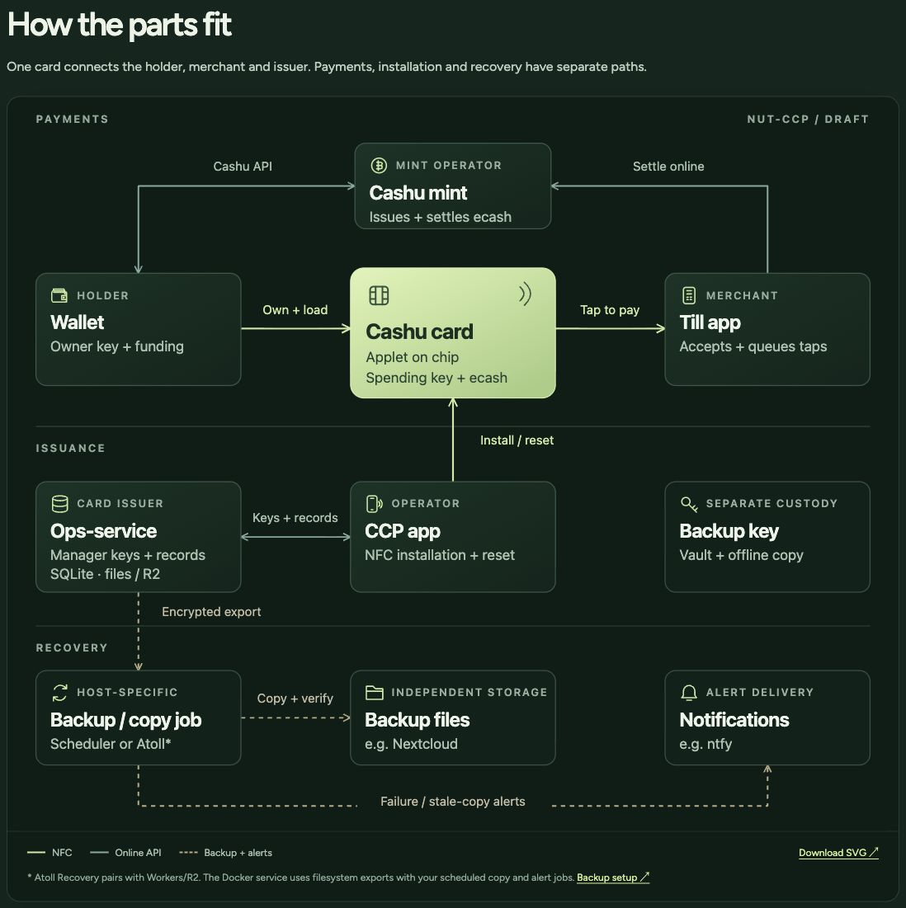

# Cashu Card architecture diagrams

The Cashu Card ecosystem diagram, published in the [developer overview](https://cashucard.org/developers#overview). It covers card payments, issuance and supporting recovery tools.



## Assets

| File | Use |
| --- | --- |
| [ecosystem.svg](ecosystem.svg) | Desktop composition, 1000 × 824 |
| [ecosystem-mobile.svg](ecosystem-mobile.svg) | Phone composition, 360 × 1168 |
| [preview.jpg](preview.jpg) | Published view with the connection legend and hosting note |

The SVGs contain editable text, shapes and connectors. Green solid lines show NFC, pale solid lines show online APIs, and dashed lines show backups and alerts.

The Atoll asterisk refers to Workers/R2 pairing. The standalone Docker service uses filesystem exports with operator-supplied scheduled copy and alert jobs. Keep this context with the diagram when reusing it.

## Regeneration

From the repository root:

```sh
python3 website/tools/ecosystem.py
python3 website/tools/ecosystem.py --check
```

The [generator](../../website/tools/ecosystem.py) writes both this library's SVGs and the website copies in `website/dist/assets/`. Update both compositions together and refresh the preview when their appearance changes. The original diagram was published in [PR #183](https://github.com/cashucard/cashucard/pull/183).

## License

MIT, under the repository's [license](../../LICENSE).
