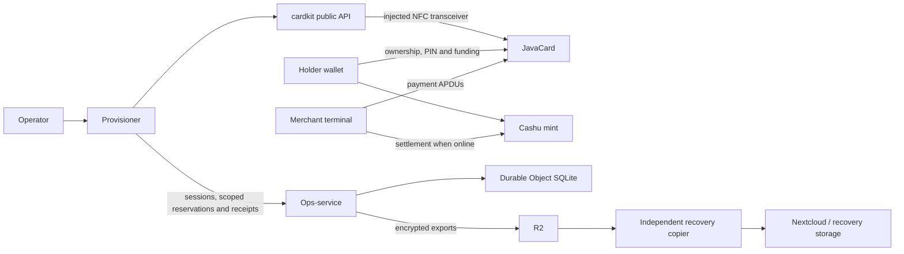

# Architecture

Cashu Card is an open protocol and a set of reference components. This
repository owns the protocol, firmware, installation library, provisioner,
ops-service, recovery copier and public website. Wallets and merchant terminals
integrate the protocol from their own repositories. See [DECISIONS](DECISIONS.md)
for settled design calls and [COMPONENT-RELEASES](COMPONENT-RELEASES.md) for the
version and deployment contracts.

## Components and ownership

| Component | Source | Responsibility |
| --- | --- | --- |
| Protocol | `spec/` | APDUs, ownership, spending and interoperability; this is the edit authority. `cashucard/javacard` mirrors the committed specification after merge. |
| Firmware | `applet/` | JavaCard 3.0.5 applet, on-card keys/proofs, spend protection and NFC tag. The tracked CAP and its hashes are release evidence. |
| cardkit | `tools/cardkit/` | Environment-neutral TypeScript API for installation, SCP02 manager-key rotation, interrupted-install recovery and owned-card reset. It receives an APDU transceiver; it does not open NFC, call HTTP or decide operator authorization. |
| Provisioner | `apps/provisioner/` | React Native operator app (`com.islandbitcoin.provisioner`): sign-in, batch setup, card installation, saved recovery, status and reset. Platform NFC and HTTP adapters surround cardkit. |
| Ops-service | `ops/` | Operator sessions/administration, reservations, chip binding, manager-key escrow, durable installation/reset records, recovery fences and encrypted exports. Node/SQLite is the local adapter; Workers/Durable Object SQLite is the deployment adapter. |
| Independent recovery copy | `tools/backup-copy/` | Copies and verifies encrypted R2 exports into independent storage and reports freshness. Its process needs transfer credentials, not the decryption identity. StartOS/Atoll packaging lives separately. |
| Host tools and simulator | `tools/cardctl/`, `tools/cardsim/` | PC/SC reference driver and hardware-free protocol simulation. The simulator's external client/routes remain a contract with wallet and terminal repositories. |
| Public site | `website/` | Protocol introduction, implementation links and installation guide. It is not the operator app or an ops-service deployment. |

Flash Mobile, Foxy and Flash POS are external implementations, not required
wallet brands. Mint interactions are implemented by wallets/terminals and
[the separate client library](https://github.com/cashucard/client). A batch's
mint reference is operator metadata; the provisioner does not set holder
ownership, fund the card, or make it spend-ready.

## Trust and data flow

The mint issues proofs and determines whether redemption succeeds. An offline
terminal's local acceptance is not a mint settlement receipt. It retains its
payment and change obligations until reconciliation; the ops-service does not
settle payments or hold the holder wallet's recovery phrase.

The card generates its secp256k1 installation key on chip. Proofs are locked to
that key. The holder controls a separate P-256 owner key through a holder
wallet; Flash's tested setup derives it from the wallet's recovery phrase.
Neither the provisioner nor an ops-service operator becomes the card owner by
installing the applet. Ownership, PINs, limits and mint personalization are
holder-wallet responsibilities.

GlobalPlatform manager keys are a third authority: they authorize applet
management, not payment ownership. Issued keys are scoped/escrowed by the
ops-service and used for the reserved installation or reset. Phone journals
retain public identifiers, intents and receipts, never manager keys, PINs,
session tokens or wallet recovery phrases. The SCP02 implementation and
vendored DES are justified in [D27](DECISIONS.md#d27); failed authentication is
not retried.

Encrypted backup files and their private recovery identity have separate
custody. The recovery identity belongs in the designated restricted vault and
protected offline copy, not R2, Nextcloud or the copier configuration. A fresh
independent copy is an admission requirement for card changes; restoring data
also installs the recovery fences before issuance resumes. See
[OPS-THREAT-MODEL](OPS-THREAT-MODEL.md) and the recovery runbooks.

## Installation and reset boundaries

`apps/provisioner/src/cardkit.ts` is the phone's adapter to the public package.
Runtime consumers import `@cashu-card/cardkit` or the explicit optional
`@cashu-card/cardkit/cleanup` API. `@cashu-card/cardkit/testing` exposes the
Node-only fake for tests; it must never enter a mobile/Worker runtime bundle.
Private `gp/*` imports are unsupported. Native Metro and ordinary Node receive
the same API through different package export conditions.

The workflow saves request IDs before HTTP and durable intent before card
commands. It reconciles the same attempt after interruption, verifies card
identity before mutation, and freezes completion evidence before posting it.
A record-only retry never starts NFC or another rotation. A stopped attempt's
chip remains fenced until an authorized reconciliation, not merely until its
screen is dismissed.

Owned-card reset is an explicit workflow: inspect public identity/state, resolve
any value/settlement obligations, confirm erasure and holder authorization where
required, use the source installation's escrow, verify removal and manager-key
state, and obtain the service receipt. It is not permission to discard uncertain
value or to reinstall an arbitrary provisioned card. A successful reinstall
creates a new installation key; old proofs cannot be recovered by replacing the
applet. See [OWNED-CARD-MOBILE-RESET](OWNED-CARD-MOBILE-RESET.md).

The card's full applet AID is `F043415348554341524401`; the package AID reaches
an opener on hardware. Installation orders opener, Cashu applet, then tag;
deletion reverses references before deleting the package. CAP/load-file pins
and deployment instructions are checked together. Host package releases do not
change those pinned bytes.

## Versions, builds and deployments

| Component | Version authority | Tag |
| --- | --- | --- |
| Firmware | `applet/pom.xml`, aligned with CAP path and protocol version | `firmware-vX.Y.Z` |
| cardkit | `tools/cardkit/package.json` | `cardkit-vX.Y.Z` |
| Provisioner | `apps/provisioner/package.json` plus matching native version/build | `provisioner-vX.Y.Z-build.N` |
| Ops-service | `ops/package.json` | `ops-vX.Y.Z` |

A protocol major/minor move changes the firmware's SELECT/GET_INFO version and
requires coordinated interoperability work. An app build or ops-service deploy
does not imply a protocol change. A cardkit API change follows its own version
and documented compatibility policy. File dependencies deliberately consume the
committed package built in the same checkout; external consumers use the packed
release. There is no implicit npm publication.

Tags must identify a commit on main and match its component manifest. Component
release pipelines require the full CI matrix before building artifacts. Firmware
publishes the tracked, pinned CAP, rather than the timestamp-different CI
conversion. Ops releases contain separate staging/production bundles and a hash
manifest. Deploy and store-upload workflows are explicit, environment-scoped
steps; pushing an ordinary branch cannot deploy production or upload a store
build. See [COMPONENT-RELEASES](COMPONENT-RELEASES.md) for signing/secret setup and
remaining external configuration.

## Verification and evidence

Affected-component CI uses a conservative allowlist. UI changes run provisioner
checks; native/build changes also run the Android native build; website-only
changes run site checks. Protocol, firmware, cardkit, ops admission/auth/schema,
phone persistence/recovery, workflow policy, recovery contract tests and unknown
source paths retain full integration. Missing diff history also runs everything.
The always-running `CI gate` rejects failed, cancelled, missing or unexpectedly
skipped selected jobs. Branch protection should require that gate.

jCardSim and fake transports prove protocol/workflow logic; they cannot prove
EEPROM behavior, RF stability, torn writes or silicon cryptographic framing.
The [23 October physical E2E report](HARDWARE_TEST_REPORT_2026-10-23.j3r180-full-e2e.md)
records the particular card/phones and tested online/offline payment and
settlement loop. The [mobile reset report](HARDWARE_TEST_REPORT_2026-10-23.j3r180-mobile-reset.md)
records reset/reinstall evidence. These are bounded observations, not blanket
compatibility or production-safety claims for all devices/cards.

For wire and data layouts, use [NUT-XX](../spec/NUT-XX.md) and
[APDU](../spec/APDU.md). For zero-allocation and hardware rules, use
[CONTRIBUTING](../CONTRIBUTING.md) and [AGENTS](../AGENTS.md).
