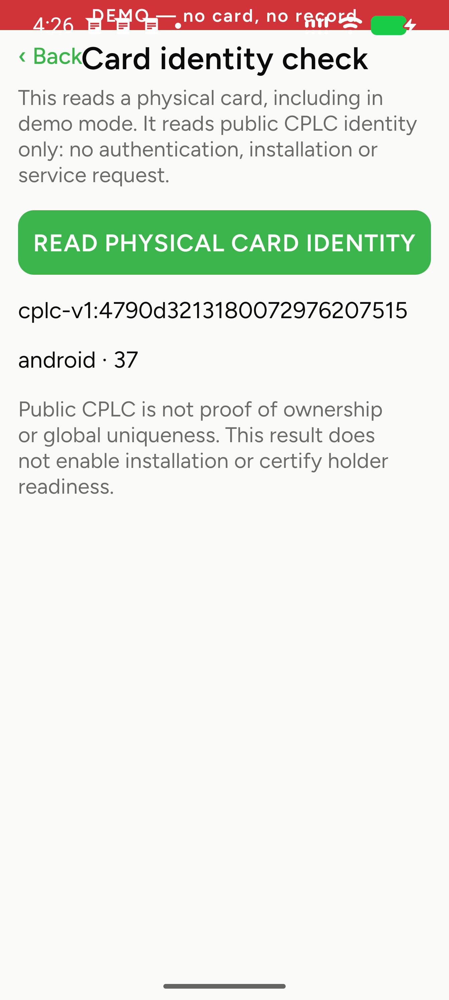
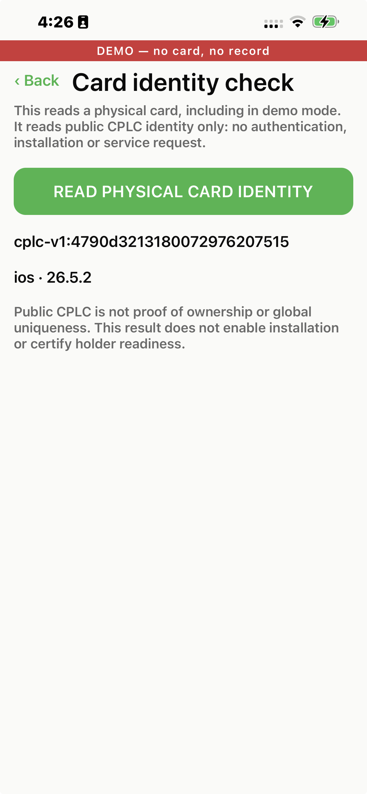
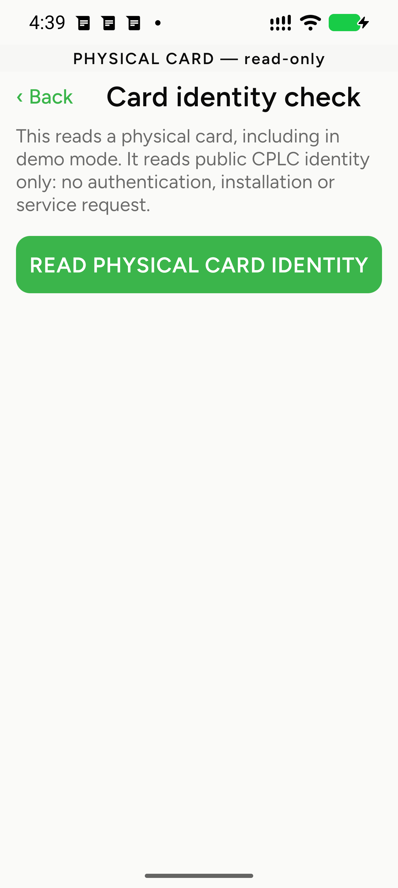

# Phone CPLC identity validation

ENG-741, 2026-10-20. The operator explicitly authorized rebuilding and launching
the provisioner on the connected Pixel and Max and starting read-only identity
checks. Three documented reads on each phone returned the same CPLC identity as
the USB baseline. Pixel results were observed over ADB; Max read 1 is supported
by a supplied screenshot and Max reads 2–3 by explicit operator confirmation. The bounded execution scope is recorded in
[the device plan](PROVISIONER-DEVICE-VALIDATION.md#authorized-read-only-phone-run--2026-10-20).
No installation, key rotation, authentication, PIN/owner operation, app-data
clearing or production-service request is authorized by this run.

## Build and environment

| Item | Observation |
|---|---|
| App/cardkit source | Merged #19, `1b54cf93459aeca39870b3030104071481589cff` |
| Checkout | Isolated `cashu-card-phone-validation`; main checkout's sign-in edits preserved |
| Installation gate | `CARD_INSTALLATION_VALIDATED = false` |
| Android | Pixel 8 Pro, ADB `42201FDJG00048`, Android 17 / API 37, security patch 2026-10-05 |
| iOS | Max, iPhone 13 Pro Max (`iPhone14,3`), UDID `00008110-001E4CC014D8401E`, iOS 26.5.2 / build 23F84 |
| Native application ID | `com.islandbitcoin.provisioner` on both platforms |
| Android build | `assembleDebug`, arm64-v8a, port 8083; succeeded, installed with existing data preserved, launched |
| Android runtime | Node 22.23.3 Metro on 8083, ADB reverse; existing servers left running |
| iOS build | Xcode 26.6 / 17F113, signed Release, built, installed and launched on Max |
| iOS JS | `main.jsbundle` embedded; no Metro dependency |
| iOS NFC | Signed `TAG` entitlement; compiled Info.plist lists ISD `A000000151000000` first |
| Native storage | Pod install resolves RNCAsyncStorage 2.2.0; generated lockfile addition recorded with this run |
| Card | Operator's card from the prior USB baseline; no applet/CAP inspection in this check |

The Android APK SHA-256 is
`c838bcf08aed9e9a9a285f893b60964a9ef428f5f8404de7ffbb93032a3a5e80`.
The iOS embedded JS SHA-256 is
`90d00a7ec23915644fad4763adffe9be3fa0f52b4e0a6afaf0775a63215d1498`;
the signed app executable's SHA-256 is
`e199be241f34afbb82374ab405377113db6a7ad47df3554f3c12e21c7befbccb`.
The tracked reference CAP SHA-256 remains
`f27d92ba99581f4e42abda0efc038b2c31128f9b405bcec6de52f6a12ae4c7e5`.
This does not attest that this CAP is installed on the card.

## Procedure and observed results

The app's explicit read-only Settings identity probe was reached through the
demo door, without signing into a service. Its strict reader selects the full
ISD AID and reads CPLC. No card-manager key is requested or used. The source's
APDU allowlist is SELECT ISD `00A4040008A00000015100000000`, then GET DATA CPLC
`80CA9F7F00`; this run does not capture the native APDU transport, so those bytes
are an implementation reference, not a silicon transcript.

The [USB baseline](HARDWARE_TEST_REPORT_2026-10-20.d321-cplc.md) is
`cplc-v1:4790d3213180072976207515`.

| Phone/read | Observation time (UTC) | Outcome |
|---|---|---|
| Pixel 1 | 23:22:24 | UI result independently observed over ADB: exact USB-baseline ID |
| Pixel 2 | 23:23:40 | Fresh session; waiting state observed, then exact USB-baseline ID after requesting removal/re-approach |
| Pixel 3 | 23:25:40 | Fresh session; operator confirmed removal/re-approach; UI result independently observed over ADB: exact USB-baseline ID |
| Max 1 | 23:26:34 (screenshot time) | Operator-provided screenshot inspected: exact USB-baseline ID and `ios · 26.5.2` |
| Max 2 | Confirmed by 23:28:16 | Operator confirmed a separate read matched the full USB-baseline ID |
| Max 3 | Confirmed by 23:28:16 | Operator confirmed another separate read matched the full USB-baseline ID |

All three observed Pixel reads match the USB baseline. The operator confirmed
presenting the same card to the Pixel. A new Android
read can remain waiting while the card is already at the phone; removal and
re-approach after arming was requested. Result text and request availability
were read from the app's UI hierarchy. Max read 1 is supported by the operator-provided screenshot below. Subsequent
operator-reported reads are distinguished from independently captured device
results.

## UI observations

The Pixel screenshot shows the demo banner overlapping the system status bar
and the Back/title row crowded. The full identity and read/cancel controls were
usable. The shared demo banner still says “no card” on this explicitly physical
read-only screen; its body correctly describes the real-card action. These are
UI follow-ups, not evidence of a card/protocol failure. The Android readout's
`37` is the platform API level; the OS release is Android 17.

## Limits and release status

The read-only cross-phone identity check passes for this one card: three
documented reads per phone match the USB baseline. The broader installation
release gate remains closed.
No install/reinstall or rotation occurred; no post-install identity stability,
termination persistence, interrupted-install recovery, distinct-card sample,
fleet uniqueness or personalization was tested. Installation remains disabled.

## UI-only follow-up, approximately 23:39–23:40 UTC

Source `2d00ca9e81049231df939d0569b7e9668d69e7b6` fixes the observations above:
measured native safe areas, a normally laid out wrapping title, theme-aware
status-bar icons, a physical read-only banner and scrollable diagnostic content.
`react-native-safe-area-context` 5.10.1 compiled in Android Debug and iOS Release
against this app's React Native 0.77.1; the new native module requires rebuilding.

Both approved phones were rebuilt, installed over the existing app and launched,
without clearing data. Pixel now uses isolated Metro port 8084; the earlier
8083 server was left untouched. The Pixel identity screen was reached through
the demo door without pressing Read. ADB bounds showed Back ending at x=247 and
the title beginning at x=358; the physical banner sits below the system status
bar. The screenshot shows readable status icons and no header collision.

Max's updated Release app was installed/launched; its revised layout was not
independently captured or visually confirmed in this follow-up. No additional
CPLC reads, authentication, service login, installation, rotation or recovery
drill ran. The six identity observations and their original build hashes above
remain evidence for source `1b54cf9`, not a claim of six retests on this revision.
